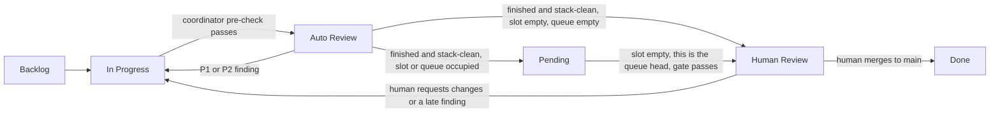

# Workflow

## Artifacts

- **Issue.** States one goal, the approach, and acceptance criteria. The human approves it before work starts.
- **Brief.** The coordinator's instructions to one worker for one issue. See [briefs.md](briefs.md).
- **Pull request.** One per issue, branched from main and targeting main. It starts as a draft.
- **Board.** One card per issue or pull request. The column says what happens next.
- **Staging branch.** An integration branch that collects changes for testing on the staging environment. It is never merged into main.

## Board columns

| Column | Meaning | Who moves the card in |
|---|---|---|
| Backlog | Approved or proposed, not started | Coordinator or human |
| In Progress | A worker is writing or fixing code. The pull request is a draft | Coordinator |
| Auto Review | Ready for review. The pull request is marked ready and the automated reviewer is running | Coordinator |
| Pending | A short, ordered buffer of finished pull requests (target: three). Each one already merges cleanly onto main, onto the single Human Review pull request if one is there, and onto every Pending pull request ahead of it. The pull request body names that stack. If the plain branch conflicts with the stack, a worker creates a <branch>-vN rebase (v0 is the original branch) and the card stays in In Progress until that branch is pushed and stack-clean. The coordinator starts new work only to refill this buffer | Coordinator or gate |
| Human Review | Exactly one finished pull request that passed the gate, is on staging, and waits on the human to test and merge to main. The next card enters only when this slot is empty, usually by promoting the head of the Pending queue | Gate only |
| Done | Merged to main | Human, or the board on merge |

Moving a card to Auto Review also means marking the pull request ready. Moving it back to In Progress means converting it to a draft.

An issue card stays on the board only until a pull request links it. Once a pull request links the issue, remove the issue card. The pull request card carries the work from then on, so each change shows up once and Human Review lists only pull requests. An issue with no pull request never goes in Human Review or Pending. If it's waiting on the human, put a question on it and leave it where it is.

## The loop

1. The human approves an issue.
2. The coordinator writes a brief and starts a worker. The card moves to In Progress.
3. The worker cuts a branch from main, opens a draft pull request early, and pushes code with tests.
4. The coordinator runs its pre-review check (see [review.md](review.md)).
5. The coordinator marks the pull request ready, moves the card to Auto Review, and requests an automated review.
6. For each P1 or P2 finding, the coordinator converts the pull request to a draft, moves the card to In Progress, and relays the finding to the worker with the root-cause rule. The worker fixes and pushes. The coordinator verifies the fix, resolves the thread, and returns to step 5.
7. After the round cap, the worker still fixes findings, but the coordinator verifies them itself and requests no more automated reviews.
8. When no P1 or P2 findings remain, the coordinator runs its post-review check.
9. The coordinator merges the change into the staging branch, redeploys staging, and checks that the commit staging serves contains the current head and that staging can run the change.
10. For any change a person can see, current screenshots or frames from staging go into the pull request description. The description also says where and how to see the change.
11. When Human Review is empty, the coordinator takes the head of the Pending queue, or a finished pull request if the queue is empty, and checks the full gate in [review.md](review.md). Only if it passes does the card move to Human Review. Human Review holds exactly one pull request. A finished pull request that cannot enter the slot goes to Pending if it is clean on the current stack.
12. The human reviews. If he merges to main, the card goes to Done and the next Pending item is promoted into the empty slot. If he sends the change back, the card returns to step 6, and the coordinator still promotes the next Pending item, then re-checks the rest of the buffer against the new stack. Start new In Progress work only to refill Pending up to the target.

## Definition of ready

An issue is ready for a worker when:

- The human has approved it.
- It states the goal, the approach, and what is out of scope.
- It has acceptance criteria someone can check.
- The human's stated choices are written into it.
- It is not started just to sit behind other work. New In Progress work starts only to refill the Pending buffer.

## Definition of done

A change is done when:

- The human has merged it to main.
- Its tests ran green on the final head, with pass counts reported.
- Every review finding is fixed at its root cause, with neighboring cases tested.
- It ran on a staging deploy that contained its final head, with screenshots or frames in the pull request if it changed anything a person can see.
- No review threads are open.

## Just-in-time review

Human Review holds exactly one pull request. Pending is a small, mutually clean buffer in front of that slot. Each Pending pull request must merge cleanly onto main, onto the Human Review pull request if one is there, and onto every Pending pull request ahead of it, in queue order. The pull request body names that stack.

If a finished pull request's plain branch conflicts with the stack, a worker rebases the work onto the stack as <branch>-vN (the next free number; v0 is the unadorned original). The worker pushes that branch only and leaves the original branch and the pull request head untouched. The card stays in In Progress until the vN branch is pushed and is stack-clean, and then it may enter Pending.

When the human merges the Human Review pull request or sends it back, the slot is empty. The coordinator promotes the head of the Pending queue through the gate. If the head used a vN branch and the previous Human Review pull request merged, the coordinator updates the pull request head to that tip. If the previous pull request was sent back, the coordinator re-checks every remaining Pending pull request against the new stack and requests a new vN branch only when the plain branch no longer applies cleanly. A Pending pull request whose plain branch is still clean keeps that branch.

The target size of the Pending buffer is three. The In Progress column should stay small (at most three). Start new work only to refill Pending. The buffer runs empty only when there is no remaining work.
