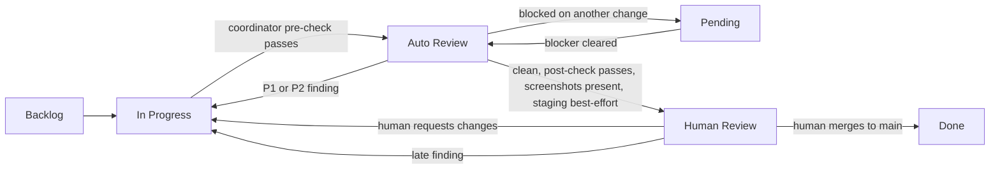

# Workflow

## Artifacts

- **Issue.** States one goal, the approach, and acceptance criteria. The human approves it before work starts.
- **Brief.** The coordinator's instructions to one worker for one issue. See [briefs.md](briefs.md).
- **Pull request.** One per issue, branched from main and targeting main. It starts as a draft.
- **Board.** One card per issue or pull request. The column says what happens next.
- **Staging branch.** An integration branch that collects changes for testing on the staging environment. It is never merged into main.

## Board columns

| Column | Meaning | Who moves the card in |
|---|---|---|
| Backlog | Approved or proposed, not started | Coordinator or human |
| In Progress | A worker is writing or fixing code. The pull request is a draft | Coordinator |
| Auto Review | Ready for review. The pull request is marked ready and the automated reviewer is running | Coordinator |
| Pending | A queue of otherwise ready pull requests, sorted by conflict count. Independents wait here with no rebase. The queue head enters Human Review as soon as a slot opens | Coordinator |
| Human Review | Passed the gate. Waiting on the human. Exactly two pull requests. Pull requests only | Coordinator |
| Done | Merged to main | Human, or the board on merge |

Moving a card to Auto Review also means marking the pull request ready. Moving it back to In Progress means converting it to a draft.

An issue card stays on the board only until a pull request links it. Once a pull request links the issue, remove the issue card. The pull request card carries the work from then on, so each change shows up once and Human Review lists only pull requests. An issue with no pull request never goes in Human Review or Pending. If it's waiting on the human, put a question on it and leave it where it is.

## The loop

1. The human approves an issue.
2. The coordinator writes a brief and starts a worker. The card moves to In Progress.
3. The worker cuts a branch from main, opens a draft pull request early, and pushes code with tests.
4. The coordinator runs its pre-review check (see [review.md](review.md)).
5. The coordinator marks the pull request ready, moves the card to Auto Review, and requests an automated review.
6. For each P1 or P2 finding, the coordinator converts the pull request to a draft, moves the card to In Progress, and relays the finding to the worker with the root-cause rule. The worker fixes and pushes. The coordinator verifies the fix, resolves the thread, and returns to step 5.
7. After the round cap, the worker still fixes findings, but the coordinator verifies them itself and requests no more automated reviews.
8. When no P1 or P2 findings remain, the coordinator starts the post-review check, a best-effort staging merge and deploy, and the gate check at once, even if CI on that head is still running. CI can finish in parallel. Do not retake screenshots.
9. Staging deploy is best-effort. The coordinator merges the change into the staging branch and redeploys staging when it can. Do not block Human Review if the body does not name the served commit, or if a served-tree check for dropped lines would fail.
10. For any change a person can see, screenshots or frames go into the pull request description. Existing screenshots count, even from an older head; do not retake them. The description also says where and how to see the change.
11. The coordinator checks the full gate in [review.md](review.md). Only if it passes does the card move to Human Review. The Linux checks on the current head must be green before the card can enter Human Review, even though the other steps started while CI was still running.
12. The human reviews. He merges to main, or sends the change back with comments, which returns it to step 6.
13. When a Human Review pull request merges, the coordinator promotes the head of the Pending queue at once, so Human Review holds two again. The reviewer moves on to the other Human Review pull request.
14. While Human Review holds two pull requests and any work is in progress, the coordinator keeps one fully gated ready-next pull request that can enter once both merge. Prefer a pull request that conflicts with nothing. Only when none exists, rebase one pull request onto main plus both Human Review pull requests and gate that tip. If the reviewer rejects a Human Review pull request, rebuild that speculative tip without it.
15. If Human Review becomes empty while work is in progress, the swarm manager tells the reviewer at once, and names the next pull request and its ETA.

When CI completes for a pull request head that is in Auto Review or Pending, a webhook event re-runs the gate in step 11. This is event-driven, not a timer.

## Definition of ready

An issue is ready for a worker when:

- The human has approved it.
- It states the goal, the approach, and what is out of scope.
- It has acceptance criteria someone can check.
- The human's stated choices are written into it.
- It does not depend on unmerged work, or the dependency is named and the card can sit in Pending.

## Definition of done

A change is done when:

- The human has merged it to main.
- Its tests ran green on the final head, with pass counts reported.
- Every review finding is fixed at its root cause, with neighboring cases tested.
- It ran on a staging deploy that contained its final head, with screenshots or frames in the pull request if it changed anything a person can see.
- No review threads are open.

## Blocked work

A change that is otherwise ready but waits on another change goes to Pending, not Auto Review or Human Review. Its pull request body names the blocker. When the blocker merges, the coordinator rebases or merges main into the branch and resumes the loop.
