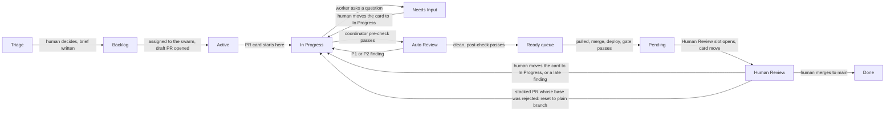

# Workflow

## Artifacts

- **Issue.** Gives one goal, the approach, and the acceptance criteria. Work starts as an issue in Triage. The human decides what to build in a comment on that issue. The title tells the present state. Each issue has a type: Feature, Bug, or Task. See [working-agreements.md](working-agreements.md).
- **Brief.** The instructions of the owner bot to one worker for one change. A change is a full issue or a named part of one. See [briefs.md](briefs.md).
- **Pull request.** One for each change of a worker. Its branch starts from main, and it targets main. It starts as a draft. An issue usually becomes one pull request. But you can divide a large issue into many pull requests. Each one has its own worker and branch, and each one names the part of the issue that it covers. A partial pull request refers to the issue without a closing keyword, for example `Part of #N`. Only the pull request that completes the acceptance criteria of the issue uses a closing keyword, such as `Fixes #N`. Thus a merge of a partial change does not close the issue too early. The title completes the sentence "Merging this pull request will ..." and starts with a verb in the imperative.
- **Board.** One card for each issue or pull request. The column tells what occurs next.
- **Staging branch.** An integration branch that collects changes for tests on the staging environment. It is never merged into main.

## Milestones

A pull request has the same milestone as the issue that it fixes. Then a board with a milestone filter shows the issues and the pull requests together.

- When you open a pull request for an issue that has a milestone, set the same milestone on the pull request.
- When an issue gets a milestone, or its milestone changes, while a pull request for it is open, set that milestone on the pull request.
- If one pull request fixes issues with different milestones, use the milestone with the earliest deadline.
- The coordinator checks this on each board sweep. It fixes each pull request whose milestone is not the same as the milestone of its issue.

## Board columns

| Column | Holds | Who moves the card in |
|---|---|---|
| Inbox | Items that are out of the flow for now. After launch, new tickets from customers. A sandboxed agent reviews each ticket, does the steps to see the problem (if there is a problem), and suggests what to do | All |
| Discuss | Issues that need careful thought or a conversation. They wait here so that simple Triage items move first | Human |
| Triage | Open issues only. Each one has clear suggested plans from an agent (the owner bot), as options on the issue. Questions for the human also go on the issue, and the issue stays in Triage. The issues wait on the human to decide whether or when to do the work, to select a plan, or to send the issue back for more plans | Coordinator |
| Backlog | Open issues only. Each one has an approved plan, but it is not in the current sprint. Workers can take these lower-priority issues when they have time | Human or coordinator |
| Active | Open issues only. Each one is assigned to the swarm, and has sub-issues or a linked open pull request | Coordinator |
| In Progress | Draft pull requests for active issues. A worker works on each one now | Coordinator |
| Auto Review | Pull requests that are marked ready. The worker is finished, and the automated, adversarial reviewer runs | Coordinator |
| Needs Input | Draft pull requests where the worker needs more information. The latest comment is a question from the worker or the coordinator that a human must answer. Examples: a missing decision, configuration, credential, or service. A comment does not move the card out of this column. The human moves the card out | Coordinator (in), human (out) |
| Human Review | Finished pull requests that were promoted from the front of Pending. They wait on the human to test and merge them to main. Exactly two pull requests whenever two are ready, and never more than two. See [Just-in-time review](#just-in-time-review) | Coordinator, from the front of Pending |
| Pending | A buffer of 3 to 5 fully prepared pull requests. Each one is pre-merged onto main, the Human Review pull requests, and the Pending pull requests ahead of it. Each one is already gated and on staging. The first pull request goes into Human Review immediately when a slot opens. That step is only a card move | Coordinator |
| Done | Pull requests that are merged to main | Human, or the board on merge |
| Canceled | Closed pull requests that will not merge. This is an error state: work started that must not have started | Human or coordinator |
| Parked | Draft pull requests with real work that we decided not to merge into main or staging yet. This column is usually empty | Human or coordinator |

After Auto Review is clean and the post-check of the coordinator passes, the pull request joins the Ready queue. The Ready queue can be a board column or an internal sorted list. The exact form is open. A pull request in the Ready queue is not merged into the staging branch, not deployed, and not gated, until the coordinator pulls it into Pending.

When you move a card to Auto Review, also mark the pull request ready. When you move a card back to In Progress or Needs Input, also change the pull request to a draft.

A comment from the human on a pull request in Human Review, or on a card in Needs Input, does not move the card. The human can come back later and add more comments. Only a column move by the human starts the next step of the workflow:

- Human Review to In Progress means that the human rejected the change. The coordinator sends the comments of the human to the worker, and the loop goes back to the fix step.
- Needs Input to In Progress means that the human answered the questions. The coordinator sends the answers to the worker, and the worker continues the work.

Automation must act directly on these column-move events. A comment event is not a signal to move the card.

Discuss is a side column. It is not a step in the loop. It holds issues that need careful thought or a conversation. They wait here so that simple Triage items move first. The coordinator does not start a worker for a Discuss item. It does not count a Discuss item as waiting on the human. The human writes comments on the issue. The agent then writes the issue body again to agree with the answers. This continues until the issue is ready for Backlog or Active. Agents do not move the card forward themselves. On a board that also has Inbox and Triage, Discuss is after Inbox and before Triage.

### Issues and pull requests on the board

Each pull request card must have a Status. Set a new card to In Progress if the pull request is a draft or still gets pushes. If not, set it to Auto Review and request a review. Never leave the Status empty.

Issues and pull requests use different columns. Issues go in Inbox, Discuss, Triage, Backlog, and Active. Pull requests go in all the columns from In Progress to Parked. Do not remove an issue card when a pull request links it. The issue moves to Active and stays there while the pull request is open. When the human merges the pull request, close the issue, move it out of Active, and delete the branch. When the blocker of a waiting pull request merges, the coordinator updates the pull request. That pull request can then join the Ready queue, or be pulled into Pending when the buffer has space.

When the human approves an issue, the coordinator starts a worker. The worker pushes a first commit on its branch. Then the coordinator assigns the issue to the swarm and opens a draft pull request from that branch, with a closing link such as `Fixes`. Only then does the issue card move to Active, and only then does the worker continue. The issue is never in Active without that link. A "Part of" mention is not a closing link.

Active holds only open issues that are assigned to the swarm and that have open sub-issues or a linked open pull request. The pull request card moves through In Progress, Auto Review, the Ready queue, Pending, and Human Review. Do not move the issue card through those columns. Do not remove it from the board while a linked pull request or a sub-issue is open.

When all the linked pull requests merged or closed, and the issue has no open sub-issues, the issue goes out of Active. If a pull request used `Fixes` (or an equivalent closing phrase) and GitHub closed the issue, the issue card goes to Done. If the issue is still open, it goes back to Triage or Backlog, as necessary.

An issue without a pull request and without open sub-issues never goes in Human Review, Pending, or Active. If it waits on the human, write a question on it and keep it in its column.



The issue card stays in Active while its pull request is open. The pull request card moves through In Progress, Auto Review, the Ready queue, Pending, and Human Review.

### Move cards without a lost step

To go into Auto Review is one action: move the card, mark the pull request ready, request an automated review of the current head, and record the head that you sent for review. A card in Auto Review without a review request or a review on its current head is a stall. A change that is at the round limit does not go back to Auto Review. The coordinator examines the new head itself (step 7 of the loop) and starts its post-check.

Sometimes the automation does not do a step because the worker is busy. Then it records the delayed step, with the pull request, the head, and the time. It checks again within 15 minutes, and on each periodic scan after that, until the worker is idle or a newer push replaces the delayed step. Then it does the delayed step on the current head. The periodic scan also looks at In Progress cards, not only at Auto Review cards. An idle worker whose head is newer than its last review goes through the pre-check and into Auto Review. If the change is at the round limit, the coordinator examines it itself.

A push after the head that the coordinator checked sends a Human Review card back to In Progress. The post-check of the coordinator names the commit that it checked. Thus it is easy to see an old pass.

## Triage

New issues and complaints go into Triage. Each issue must give the code context for the related component and tell why the problem occurs. It must give two to four numbered fix options with a recommendation. A symptom and the expected behavior are not sufficient. The maintainer must be able to select with one comment.

Work starts as an issue in Triage. The owner bot writes options in a comment on the issue. The human decides in a comment. That comment is the instruction for what to build. Edits to that comment also count. The coordinator sends the comment of the human to the owner bot.

Then the owner bot does one of these:

1. It writes its questions on the issue and keeps the card in Triage.
2. It writes a brief and moves the card to Backlog. The coordinator starts a coding worker from that brief. The branch of the worker starts from main, and the base of the pull request is main.

Parked items stay parked until the human says otherwise. Product choices belong to the owner bot. The coordinator does not make product choices.

## The loop

1. An issue goes into Triage. The owner bot writes options. The human decides in a comment.
2. The owner bot writes a brief, or it first asks questions on the issue in Triage. The coordinator starts a worker. The worker makes a branch from main, pushes a first commit, and stops.
3. The coordinator opens a draft pull request from that branch against main, with a closing link. It assigns the issue to the swarm and moves the issue card to Active. The pull request card moves to In Progress. The issue is never in Active without a link. Then the worker pushes code with tests to the pull request.
4. The coordinator does its pre-review check (see [review.md](review.md)).
5. The coordinator marks the pull request ready, moves the card to Auto Review, and requests an automated review.
6. For each P1 or P2 finding, the coordinator changes the pull request to a draft, moves the card to In Progress, and sends the finding to the worker with the root-cause rule. The worker fixes the finding and pushes. The coordinator examines the fix, resolves the thread, and goes back to step 5.
7. After the round limit, the worker continues to fix findings. But the coordinator examines them itself and does not request more automated reviews.
8. When there are no more P1 or P2 findings, the coordinator does the post-review check. If the post-check passes, the pull request joins the Ready queue. The coordinator does not merge it into the staging branch, deploy it, or run the gate yet.
9. When Pending has fewer pull requests than its target size of 3 to 5, the coordinator starts the pull step under the shared lock. See [The pull into Pending](review.md#the-pull-into-pending). It takes the first pull request in the Ready queue. If necessary, it merges main into that pull request, and the worker makes any code fixes. Then it merges the pull request into the staging branch, deploys staging again, and verifies that staging serves the correct commit. If the lock is busy, this step stops at once, reports `busy`, and tries again later.
10. For each change that a person can see, screenshots or frames go into the pull request description. Existing screenshots count, also from an older head. Do not take them again. The description also tells where and how to see the change. The pull step checks that the body is complete before the pull request enters Pending.
11. The coordinator runs the full gate in [review.md](review.md) only during the pull step. If the gate passes, the pull request goes to Pending. If the gate fails, the pull request goes back to In Progress with the reason, and the coordinator tries the next pull request in the Ready queue. A pull request does not enter Pending until the Linux checks on the current head are green and staging is verified to serve the correct commit.
12. The human reviews. He merges to main. Or he moves the card from Human Review to In Progress to reject the change. Then the change goes back to step 6. A comment in Human Review does not move the card.
13. When a Human Review pull request leaves, because the human merged it or sent it back, the coordinator immediately moves the first pull request in Pending to Human Review. This is only a card move. Then Human Review holds two again. The reviewer starts on the other Human Review pull request. Then the coordinator starts the pull step to refill Pending.
14. Do not merge, deploy, or gate any pull request other than the one that is being pulled into Pending. Pull requests in the Ready queue get no merges, gates, or checks after they join the queue. Do not make speculative rebased copies of every pull request. Do not merge the whole queue again after every merge to main. If a pulled pull request conflicts with a Human Review pull request, prefer the next pull request in the Ready queue that does not. Make a speculative rebase only if no pull request in the Ready queue fits, and make only one at a time. If the human rejects a Human Review pull request, make each affected Pending pull request again without the rejected work, one at a time.
15. If Human Review becomes empty while work continues, the swarm manager immediately tells the reviewer. It gives the next pull request and the time when it will be ready. It also fills Human Review from Pending at once, up to two pull requests, and then starts the pull step to refill Pending.

A webhook event does not run the gate for a draft pull request, or for a pull request that is in the Ready queue and has not been pulled. The hook makes those checks before it makes any API call. It also ignores repeated CI events for the same head. The hook uses the API quota of the bot app. It falls back to the human account only when the app quota fails.

A gate check, a promotion from Pending, and a merge into the staging branch take one shared lock. Only one of these operations runs at a time. If the lock is busy, the second operation stops at once, reports `busy`, and tries again later.

### Pull requests that do not target main

The human can approve a change that targets another long-lived branch, such as a deploy tools branch. It follows the same loop. It skips only the steps that cannot apply. For a change that cannot go to staging, the check that its pull request names replaces the deploy conditions of the gate. An example is the test suite of the tools, run and recorded on the current head. "Can merge into main" becomes "can merge into its base". A skipped step never means that the loop stops. After a clean automated review, the coordinator still does its post-check. The pull request then joins the Ready queue. The coordinator runs the gate only when it pulls the pull request into Pending. A Human Review slot still fills from the front of Pending.

Each pull request card gets a status in the same action that adds it to the board. The periodic scan finds each open pull request whose card has no status. It also finds each pull request whose latest automated review of the current head is clean but has no post-check after it.

## Definition of ready

An issue is ready for a worker when:

- The human decided what to build in a Triage comment, or approved the issue in a different way.
- It gives the goal, the approach, and what is out of scope.
- It has acceptance criteria that a person can check.
- It has the choices of the human in it.
- The work is not started only to wait behind other work. Start new In Progress work only to refill the Pending buffer. New workers must not take memory or API quota away from the pull request that is closest to Human Review.
- It does not depend on unmerged work, or the issue names the dependency. If its finished pull request still waits on that work, and that work is not yet in Human Review or in Pending, the pull request does not enter the Pending buffer.

## Definition of done

A change is done when:

- The human merged it to main.
- Its tests passed on the final head, and the worker reported the counts.
- Each review finding is fixed at its root cause, and the neighboring cases have tests.
- It was merged into the staging branch, and staging was verified to serve it. If it changed something that a person can see, the pull request has screenshots or frames. Existing screenshots count, also from an older head.
- No review threads are open.

## Just-in-time review

Human Review is a buffer for the attention of the human. It holds exactly two pull requests whenever two are ready, and never more than two. See the flow in [review.md](review.md#just-in-time-human-review-flow).

This rule, from 2026-11-13, replaces the 2026-11-12 two-slot and ready-next rules where they differ. The top priority is always to refill Human Review when an item leaves it.

Use independent pull requests when you can. A pull request is independent when it merges cleanly onto main, has no unmerged commits of another Human Review pull request, and merges cleanly together with each Human Review pull request. The human can merge or reject each independent pull request with no effect on the others.

Pending is a buffer of 3 to 5 fully prepared pull requests. Keep it small. It must be large enough that the human can review 4 or 5 items while the next pull request is prepared, even if about 3 pull requests in the Ready queue fail the gate in a row. "Pending" means "pending review". Each Pending pull request is already merged into the staging branch, deployed, and verified on staging. CI is green. The body is complete. All gate conditions pass. Each one is pre-merged as a speculative stack on main, plus the Human Review pull requests that we expect the human to merge, plus the Pending pull requests ahead of it. Because of this, it has no merge conflicts to fix later. Moving the first Pending pull request to Human Review is only a card move.

The Ready queue holds finished pull requests that wait to be pulled into Pending. The exact name and the implementation, a board column or an internal sorted list, are open. A pull request in the Ready queue is finished: its worker is done, the automated review is clean, and the post-check of the coordinator passed on the head. It is not merged into the staging branch, not deployed, and not gated. Ready-queue pull requests wait in this order: first those with a milestone, ordered by the milestone, then those with the fewest conflicts with the current stack, then the oldest.

The pre-merge and the gate run only when a pull request is pulled into Pending, and only one at a time. When Pending has fewer pull requests than its target size, the coordinator takes the first pull request in the Ready queue, under the shared lock in [review.md](review.md#the-pull-into-pending). It merges main into that pull request if necessary. The worker of that pull request makes any code fixes. Then the coordinator merges the pull request into the staging branch, deploys staging again, verifies the served commit, and runs the gate. If the gate passes, the pull request goes to Pending. If the gate fails, the pull request goes back to In Progress with the reason, and the coordinator tries the next pull request in the Ready queue. Expect one or two failures before a pull request fits. That is why the buffer exists.

When Human Review drops to 1, the coordinator moves the first Pending pull request to Human Review at once. Then it starts the pull step to refill Pending. If Human Review has an open slot and Pending still has pull requests, it fills Human Review first, up to two.

Do not merge, deploy, or gate any pull request other than the one that is being pulled into Pending. Pull requests in the Ready queue get no merges, gates, or checks after they join the queue. Do not make speculative rebased copies of every pull request. Do not merge the whole queue again after every merge to main. Staging gets one pull request at a time, just before that pull request enters Pending.

Prepare each pulled pull request against current main, plus the two Human Review pull requests, plus the Pending pull requests ahead of it. If it conflicts with a Human Review pull request, prefer the next pull request in the Ready queue that does not. Make a speculative rebase only if no pull request in the Ready queue fits, and make only one at a time. If you do that rebase, use a `<branch>-vN` tip (the next free number; v0 is the plain original). Install that tip as the head before the pull request enters Pending. Then run the tests, the post-check, the staging deploy, and the gate on that new head. Never run the gate on the old head and update the head after it. Never move the branch of a card that is already in Pending or in Human Review.

A pull request is rejected when the human sends it back or closes it without a merge. Each tip that is built on a rejected pull request is not valid, in Pending and in Human Review. Never install it. The coordinator moves those cards out, and the worker makes a new tip from the plain branch without the rejected work. Do this one pull request at a time, under the lock, while the human reviews the other Human Review pull request. Tell the human that you removed a card, and why.

The In Progress column must stay small. Start new work only to refill the Pending buffer. New workers must not take memory or API quota away from the pull request that is closest to Human Review. Pending goes below its target size only while the next pull request is being prepared, or when there is no more work.

### Stacked pull requests

Each Pending pull request may already contain the changes of the Human Review pull requests and of the Pending pull requests ahead of it. When such a pull request moves into Human Review, and its head still contains the changes of the other Human Review pull request, it is a stacked pull request. Thus the human still has two items to review, and the new card has no conflicts to fix. Rules:

- Human Review holds a maximum of one stacked pull request. The other Human Review pull request is not a stacked pull request.
- The head of the stacked pull request contains the commits of its base, and it merges cleanly onto main plus that base. Before the coordinator installs a new tip, it saves the plain tip as `<branch>-v0`. Thus the plain content stays available.
- The pull request body of the stacked pull request starts with this banner, before all other text. Replace A with the number of the base pull request:

  ```
  # STACKED ON #A: MERGE #A INTO MAIN FIRST

  > **This pull request contains the changes of #A.** Merge it only after #A is merged into main.
  > If #A is rejected, do not merge this pull request. The coordinator resets it to its plain branch,
  > without the changes of #A, before it can be merged.
  ```

- The gate fails a stacked pull request in these conditions. The banner is missing or not at the top. Or its head contains the commits of a Human Review pull request but has no banner. Or its base was closed without a merge or went out of Human Review.

If the human merges the base, the coordinator makes sure that the stacked pull request still merges cleanly onto main. If it does, the coordinator removes the banner. No other change is necessary. If it does not, the coordinator moves the stacked pull request out of Human Review to In Progress. For example, this occurs when the base was squash-merged and the stacked pull request still has the original commits of the base. The coordinator asks the worker to make the pull request again on the current main without the commits of the base. Then it goes through the normal loop again.

If the human rejects the base (closes it without a merge, or sends it back so that it goes out of Human Review), the stacked pull request must never merge with the changes of the base. The coordinator acts immediately, before the human can merge the stacked pull request:

1. It moves the card of the stacked pull request out of Human Review to In Progress. This step is first, so that nobody moves the branch of a card in Human Review.
2. It resets the branch to the saved plain tip (`<branch>-v0`) and removes the banner. If there is no saved plain tip, it asks the worker to make the pull request again on main without the commits of the base.
3. It does the normal loop again on the new head. Then the pull request can join the Ready queue again as an independent pull request.

The same reset applies to each Pending pull request that included the rejected work. Move those cards out of Pending and prepare them again, one at a time, under the lock.

## Live workers

A card in In Progress must have a live worker that does the work. A shell window or a saved session is not a live worker.

- When a worker finishes, parks, or stops, the same action moves its card. A finished draft goes through the pre-check, is marked ready, and moves to Auto Review. A card that waits on a decision of the human moves to Needs Input, with the open question in a comment. A card that waits on another change does not enter the Pending buffer. It names that change, and it waits until the blocker is in Human Review, is in Pending, or has merged. An issue card that has no pull request yet goes back to Backlog, with the question in a comment.
- A worker that ends its turn with a question about the next step is not finished. The coordinator answers the question, or sends it to the correct owner, in the same scan. It does not keep the card in In Progress without a worker.
- A resume that fails is a board event. The coordinator reads the result of the resume. If no worker started, the coordinator starts one, or moves the card out of In Progress.
- Each scan compares In Progress cards with live workers. A card without a live worker, or with an idle worker and no new push, is a stall. The scan fixes it in the same run.

## Blocked work

A change that is finished but waits on another change does not enter the Pending buffer, and it is not pulled from the Ready queue, until the blocker is in Human Review, is in Pending, or has merged. Then the coordinator can prepare it as a stack on that work. Its pull request body names each blocker on its own line, in a fixed form such as `Blocked by #N`. Then automation can read it. Notes in the session of a worker do not count. An issue that no pull request started yet stays in Backlog, also when it waits on other work. It uses the same `Blocked by #N` lines in its body.

Each time a pull request merges, the automation of the coordinator looks for waiting cards that name it or the issue that it closes. When all the blockers of a card merged, the coordinator rebases the branch or merges main into it if that is necessary for the worker to continue. If the worker is already done, the card can join the Ready queue and be pulled into Pending when the buffer has space. When all the blockers of a Backlog issue merged, the coordinator reports that the issue is ready for a worker. The periodic scan counts a waiting card whose blockers all merged as a stall, not as a wait. It reports each Backlog issue whose blockers all merged.

A change that waits on a person or on the environment does not go to Pending. Examples: a decision, missing configuration, credentials, or a service that staging does not have. Change the pull request to a draft and move the card to Needs Input. Write a comment that names what is missing and who must supply it. When the answer or the missing item arrives, the loop continues as the gate in [review.md](review.md) tells. A comment on that card does not move it. When the human moves the card to In Progress, the coordinator sends the answers, and the work continues.

A block must point in one direction only. Sometimes a change cannot show its evidence itself. For example, it adds code that nothing on the screen uses yet. Then the screenshot must come from the follow-up change that uses the code. The follow-up must not wait for the first change to merge, because the first change cannot go into Human Review without that evidence. That is a circular wait, and the two changes do not move. Do this:

- Start the follow-up immediately. Its branch starts from main, with the branch of the first change merged into it. Its pull request targets main and names the first change as its blocker.
- Put the staging evidence of the follow-up into the two pull request descriptions. Then the first change can pass the gate.
- On each scan, the coordinator makes sure that the blocker of each Pending card can move forward without that card. If the blocker cannot, the coordinator immediately breaks the cycle in this way.

### Blocked on the staging environment

Sometimes a change is finished and reviewed, but staging itself has a fault that the worker cannot see into. For example, each file write gives a server error, but reads and other requests work, and the worker cannot read the server logs. The worker cannot take the necessary screenshots. Thus the change cannot pass the gate.

- The worker stops and removes all that it made on staging. It ends its turn with a status line that says that it is blocked on staging. The line gives the symptom, the request that fails, and the causes that the worker examined and found not true.
- The coordinator counts that line as a handoff, not as a finished turn. In the same pass, it sends the symptom to the person who operates staging (the operator role, or the human if nobody else can read the server logs). The pull request changes to a draft, and the card moves to Needs Input. The comment names the staging fault and who must fix it.
- When the operator says that the fault is fixed, the coordinator tries the failed request itself. Then it tells the worker to finish the screenshots. The card goes back into the loop at step 10.
- A scan that finds a worker blocked on staging, with no message to the operator yet, counts it as a stall.

A staging fault also blocks all other changes that need screenshots on staging. Thus the coordinator reports the fault one time, names each change that waits on it, and continues all of them when the fault is fixed.

## Deploy automation target

On 2026-11-07, the target is to replace the Actions SSH deploy jobs with a signed GitHub push webhook. This work is not finished. This section does not say that the listener operates now.

A small listener on the shared build machine verifies `X-Hub-Signature-256` with a secret that is not in git. It accepts pushes to main and to the staging branch. It sends 202 immediately and puts the existing deploy targets in a queue under the deploy lock of the machine. It records each run. A push to main deploys the production targets again after the maintainer merges. A push to the staging branch deploys the staging targets again. Bots still never merge to main or deploy production themselves.

This stops the use of Actions minutes for deploy jobs, but not for tests. The rollout must tell where to read the deploy logs and how to send a push again. Then it must test a ping and a push that is sent again against the served commit.
