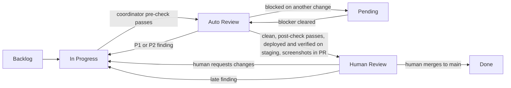

# Workflow

## Artifacts

- **Issue.** States one goal, the approach, and acceptance criteria. The human approves it before work starts.
- **Brief.** The coordinator's instructions to one worker for one issue. See [briefs.md](briefs.md).
- **Pull request.** One per issue, branched from main and targeting main. It starts as a draft.
- **Board.** One card per issue or pull request. The column says what happens next.
- **Staging branch.** An integration branch that collects changes for testing on the staging environment. It is never merged into main.

## Board columns

| Column | Meaning | Who moves the card in |
|---|---|---|
| Backlog | Approved or proposed, not started | Coordinator or human |
| In Progress | A worker is writing or fixing code. The pull request is a draft | Coordinator |
| Auto Review | Ready for review. The pull request is marked ready and the automated reviewer is running | Coordinator |
| Pending | Otherwise ready, but blocked on another change or an outside decision | Coordinator |
| Human Review | Passed the gate. Waiting on the human. Pull requests only | Coordinator |
| Done | Merged to main | Human, or the board on merge |

Moving a card to Auto Review also means marking the pull request ready. Moving it back to In Progress means converting it to a draft.

An issue card stays on the board only until a pull request links it. Once a pull request links the issue, remove the issue card. The pull request card carries the work from then on, so each change shows up once and Human Review lists only pull requests. An issue with no pull request never goes in Human Review or Pending. If it's waiting on the human, put a question on it and leave it where it is.

## The loop

1. The human approves an issue.
2. The coordinator writes a brief and starts a worker. The card moves to In Progress.
3. The worker cuts a branch from main, opens a draft pull request early, and pushes code with tests.
4. The coordinator runs its pre-review check (see [review.md](review.md)).
5. The coordinator marks the pull request ready, moves the card to Auto Review, and requests an automated review.
6. For each P1 or P2 finding, the coordinator converts the pull request to a draft, moves the card to In Progress, and relays the finding to the worker with the root-cause rule. The worker fixes and pushes. The coordinator verifies the fix, resolves the thread, and returns to step 5.
7. After the round cap, the worker still fixes findings, but the coordinator verifies them itself and requests no more automated reviews.
8. When no P1 or P2 findings remain, the coordinator runs its post-review check.
9. The coordinator merges the change into the staging branch, redeploys staging, and checks that the commit staging serves contains the current head and that staging can run the change.
10. For any change a person can see, current screenshots or frames from staging go into the pull request description. The description also says where and how to see the change.
11. The coordinator checks the full gate in [review.md](review.md). Only if it passes does the card move to Human Review.
12. The human reviews. He merges to main, or sends the change back with comments, which returns it to step 6.

## Definition of ready

An issue is ready for a worker when:

- The human has approved it.
- It states the goal, the approach, and what is out of scope.
- It has acceptance criteria someone can check.
- The human's stated choices are written into it.
- It does not depend on unmerged work, or the dependency is named and the card can sit in Pending.

## Definition of done

A change is done when:

- The human has merged it to main.
- Its tests ran green on the final head, with pass counts reported.
- Every review finding is fixed at its root cause, with neighboring cases tested.
- It ran on a staging deploy that contained its final head, with screenshots or frames in the pull request if it changed anything a person can see.
- No review threads are open.

## Blocked work

A change that is otherwise ready but waits on another change goes to Pending, not Auto Review or Human Review. Its pull request body names the blocker. When the blocker merges, the coordinator rebases or merges main into the branch and resumes the loop.

### Blocked on the staging environment

Sometimes a change is finished and reviewed, but staging itself is broken in a way the worker can't see into. For example, every file write returns a server error while reads and other requests work, and the worker can't read the server's logs. The worker can't take the required screenshots, so the change can't pass the gate.

- The worker stops, cleans up anything it created on staging, and ends its turn with a status line that says it's blocked on staging. The line names the symptom, the request that fails, and what the worker ruled out.
- The coordinator treats that line as a handoff, not as a finished turn. In the same pass, it sends the symptom to whoever operates staging (the operator role, or the human if no one else can read the server logs). The card moves to Pending, and the pull request body names the staging fault as the blocker.
- When the operator says the fault is fixed, the coordinator checks the failing request itself, then tells the worker to finish the screenshots. The card goes back into the loop at step 10.
- A scan that finds a worker blocked on staging, with no message to the operator yet, counts it as a stall.

A broken staging environment also blocks every other change that needs screenshots there. So the coordinator reports it once, names each change that is waiting on it, and resumes all of them when it's fixed.
