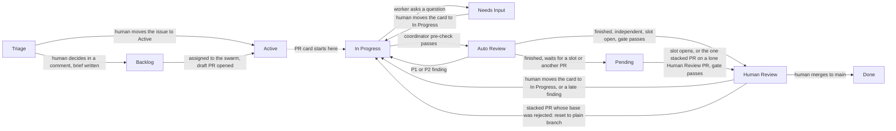

# Workflow

## Artifacts

- **Issue.** Gives one goal, the approach, and the acceptance criteria. Work starts as an issue in Triage. The human decides what to build in a comment on that issue, or by a move of the issue to Active or to Backlog. The title tells the present state. Each issue has a type: Feature, Bug, or Task. See [working-agreements.md](working-agreements.md).
- **Brief.** The instructions of the owner bot to one worker for one change. A change is a full issue or a named part of one. See [briefs.md](briefs.md).
- **Pull request.** One for each change of a worker. Its branch starts from main, and it targets main. It starts as a draft. An issue usually becomes one pull request. But you can divide a large issue into many pull requests. Each one has its own worker and branch, and each one names the part of the issue that it covers. Only one of those pull requests is in a flow column at a time. If a follow-up must run at the same time as the first change, for example to supply evidence, make the follow-up a separate issue. A partial pull request refers to the issue without a closing keyword, for example `Part of #N`. Only the pull request that completes the acceptance criteria of the issue uses a closing keyword, such as `Fixes #N`. Thus a merge of a partial change does not close the issue too early. The title completes the sentence "Merging this pull request will ..." and starts with a verb in the imperative.
- **Board.** One card for each issue or pull request. The column tells what occurs next.
- **Staging branch.** An integration branch that collects changes for tests on the staging environment. It is never merged into main.

## Milestones

A pull request has the same milestone as the issue that it fixes. Then a board with a milestone filter shows the issues and the pull requests together.

- When you open a pull request for an issue that has a milestone, set the same milestone on the pull request.
- When an issue gets a milestone, or its milestone changes, while a pull request for it is open, set that milestone on the pull request.
- If one pull request fixes issues with different milestones, use the milestone with the earliest deadline.
- If one pull request fixes more than one issue, only one of those issues is in Active. The others stay in Backlog until the pull request merges.
- The coordinator checks this on each board sweep. It fixes each pull request whose milestone is not the same as the milestone of its issue.

## Board columns

| Column | Holds | Who moves the card in |
|---|---|---|
| Inbox | Items that are out of the flow for now. After launch, new tickets from customers. A sandboxed agent reviews each ticket, does the steps to see the problem (if there is a problem), and suggests what to do. Issues with the `work2` label stay here, even when they have a linked pull request | All |
| Discuss | Issues that need careful thought or a conversation. They wait here so that simple Triage items move first | Human |
| Triage | Open issues only. Each one has clear suggested plans from an agent (the owner bot), as options on the issue. Questions for the human also go on the issue, and the issue stays in Triage. The issues wait on the human to decide whether or when to do the work, to select a plan, or to send the issue back for more plans | Coordinator |
| Backlog | Open issues only. Each one has an approved plan, but it is not in the current sprint. Workers can take these lower-priority issues when they have time | Human or coordinator |
| Active | Open issues only. Each one is assigned to the swarm, does not have the `work2` label, and has exactly one open linked pull request in a flow column (In Progress, Auto Review, Needs Input, Pending, or Human Review). The number of cards in Active equals the number of pull requests in those flow columns that belong to issues without the `work2` label | Coordinator |
| In Progress | Draft pull requests for active issues. A worker works on each one now | Coordinator |
| Auto Review | Pull requests that are marked ready. The worker is finished, and the automated, adversarial reviewer runs | Coordinator |
| Needs Input | Draft pull requests where the worker needs more information. The latest comment is a question from the worker or the coordinator that a human must answer. Examples: a missing decision, configuration, credential, or service. A comment does not move the card out of this column. The human moves the card out | Coordinator (in), human (out) |
| Human Review | Finished pull requests that passed the gate. They wait on the human to test and merge them to main. Exactly two pull requests. One stacked pull request can go in when Human Review holds only one pull request and no independent pull request is ready. See [Just-in-time review](#just-in-time-review) | Coordinator, through the gate |
| Pending | A queue of finished pull requests, sorted by conflict count. Independent pull requests wait here without a rebase. The first pull request in the queue goes into Human Review immediately when a slot opens | Coordinator |
| Done | Pull requests that are merged to main | Human, or the board on merge |
| Canceled | Closed pull requests that will not merge. This is an error state: work started that must not have started | Human or coordinator |
| Parked | Draft pull requests with real work that we decided not to merge into main or staging yet. This column is usually empty | Human or coordinator |

When you move a card to Auto Review, also mark the pull request ready. When you move a card back to In Progress or Needs Input, also change the pull request to a draft.

A comment from the human on a pull request in Human Review, or on a card in Needs Input, does not move the card. The human can come back later and add more comments. Only a column move by the human starts the next step of the workflow:

- Human Review to In Progress means that the human rejected the change. The coordinator sends the comments of the human to the worker, and the loop goes back to the fix step.
- Needs Input to In Progress means that the human answered the questions. The coordinator sends the answers to the worker, and the worker continues the work.

Automation must act directly on these column-move events. A comment event is not a signal to move the card.

Discuss is a side column. It is not a step in the loop. It holds issues that need careful thought or a conversation. They wait here so that simple Triage items move first. The coordinator does not start a worker for a Discuss item. It does not count a Discuss item as waiting on the human. The human writes comments on the issue. The agent then writes the issue body again to agree with the answers. This continues until the issue is ready for Backlog or Active. Agents do not move the card forward themselves. On a board that also has Inbox and Triage, Discuss is after Inbox and before Triage.

### Issues and pull requests on the board

Each pull request card must have a Status. Set a new card to In Progress if the pull request is a draft or still gets pushes. If not, set it to Auto Review and request a review. Never leave the Status empty.

Issues and pull requests use different columns. Issues go in Inbox, Discuss, Triage, Backlog, and Active. Pull requests go in all the columns from In Progress to Parked. Do not remove an issue card when a pull request links it. If the issue does not have the `work2` label, it moves to Active and stays there while that pull request is open in a flow column. Issues with the `work2` label stay in Inbox, even when they have a linked pull request. The pull request of a `work2` issue still moves through the flow columns in the usual way. It does not move the issue out of Inbox, and it does not count toward the Active total. When the human merges a pull request of an Active issue, close the issue, move it out of Active, and delete the branch. When the human merges a pull request of a `work2` issue, close the issue in Inbox and delete the branch. When the blocker of a Pending pull request merges, the coordinator updates the pull request and moves it to Human Review through the gate.

The human approves an issue in a Triage comment, or by a move of the issue to Active or to Backlog. A move to Active, with no comment, is sufficient approval to start the worker. A move to Backlog approves the plan, but does not start the worker yet.

When the coordinator starts a worker, the worker pushes a first commit on its branch. Then the coordinator assigns the issue to the swarm and opens a draft pull request from that branch, with a closing link such as `Fixes`. Then the issue card stays in Active, or moves to Active, and the worker continues. After the pull request is open, the issue is never in Active without that link. A "Part of" mention is not a closing link.

If the issue has open questions when the human moves it to Active, the worker takes the default or recommended answer and builds it. It does not ask the human again for those questions. It states which default it took in the pull request body. The card does not go to Needs Input for those questions.

Active holds only open issues that are assigned to the swarm, that do not have the `work2` label, and that have exactly one open linked pull request in a flow column (In Progress, Auto Review, Needs Input, Pending, or Human Review). The number of cards in Active equals the number of pull requests in those flow columns that belong to issues without the `work2` label. A pull request of a `work2` issue still moves through the flow columns, but it does not have an Active issue card and it does not count in that total. A pull request in a flow column belongs to exactly one Active issue. If one pull request fixes more than one issue, only one of those issues is in Active, and the others stay in Backlog until the pull request merges. An Active issue has only one pull request in a flow column at a time. If a follow-up must run at the same time as the first change, make the follow-up a separate issue. The pull request card of an Active issue moves through the flow columns. Do not move the issue card through those columns. Do not remove the issue from the board while that linked pull request is open.

When the issue no longer has exactly one open linked pull request in a flow column, it goes out of Active. If a pull request used `Fixes` (or an equivalent closing phrase) and GitHub closed the issue, the issue card goes to Done. If the issue is still open, it goes back to Triage or Backlog, as necessary.

An issue without a pull request never goes in Human Review, Pending, or Auto Review. The only time it is in Active without a pull request is the short interval after the human moves it there and before the coordinator opens the draft pull request. If an issue waits on the human and is not in Active, write a question on it and keep it in its column.



The issue card stays in Active while its pull request is open in a flow column. The pull request card moves through In Progress, Auto Review, Needs Input, Pending, and Human Review.

### Move cards without a lost step

To go into Auto Review is one action: move the card, mark the pull request ready, request an automated review of the current head, and record the head that you sent for review. A card in Auto Review without a review request or a review on its current head is a stall. A change that is at the round limit does not go back to Auto Review. The coordinator examines the new head itself (step 7 of the loop) and starts its post-check.

Sometimes the automation does not do a step because the worker is busy. Then it records the delayed step, with the pull request, the head, and the time. It checks again within 15 minutes, and on each periodic scan after that, until the worker is idle or a newer push replaces the delayed step. Then it does the delayed step on the current head. The periodic scan also looks at In Progress cards, not only at Auto Review cards. An idle worker whose head is newer than its last review goes through the pre-check and into Auto Review. If the change is at the round limit, the coordinator examines it itself.

A push after the head that the coordinator checked sends a Human Review card back to In Progress. The post-check of the coordinator names the commit that it checked. Thus it is easy to see an old pass.

## Triage

New issues and complaints go into Triage. Each issue must give the code context for the related component and tell why the problem occurs. It must give two to four numbered fix options with a recommendation. A symptom and the expected behavior are not sufficient. The maintainer must be able to select with one comment.

Work starts as an issue in Triage. The owner bot writes options in a comment on the issue. The human decides in a comment, or by a move of the issue to Active or to Backlog. A comment is the instruction for what to build. Edits to that comment also count. The coordinator sends the comment of the human to the owner bot. A move to Active, with no comment, is sufficient approval to start the worker.

Then the owner bot does one of these:

1. It writes its questions on the issue and keeps the card in Triage, unless the human already moved the issue to Active.
2. It writes a brief and moves the card to Backlog, unless the human already moved the issue to Active. The coordinator starts a coding worker from that brief. The branch of the worker starts from main, and the base of the pull request is main.

If the human moves the issue to Active while questions are still open, the worker does not wait. It takes the default or recommended answer, builds that answer, and states the default in the pull request body. The card does not go to Needs Input for those questions.

Parked items stay parked until the human says otherwise. Product choices belong to the owner bot. The coordinator does not make product choices.

## The loop

1. An issue goes into Triage. The owner bot writes options. The human decides in a comment, or by a move of the issue to Active or to Backlog.
2. The owner bot writes a brief, or it first asks questions on the issue in Triage. If the human moved the issue to Active, the coordinator starts a worker even when questions are still open. In that case the worker takes the default or recommended answer. The worker makes a branch from main, pushes a first commit, and stops.
3. The coordinator opens a draft pull request from that branch against main, with a closing link. It assigns the issue to the swarm and moves the issue card to Active, or keeps it there. The pull request card moves to In Progress. After the pull request is open, the issue is never in Active without a link. If the worker took a default answer, the pull request body states which default it took. Then the worker pushes code with tests to the pull request.
4. The coordinator does its pre-review check (see [review.md](review.md)).
5. The coordinator marks the pull request ready, moves the card to Auto Review, and requests an automated review.
6. For each P1 or P2 finding, the coordinator changes the pull request to a draft, moves the card to In Progress, and sends the finding to the worker with the root-cause rule. The worker fixes the finding and pushes. The coordinator examines the fix, resolves the thread, and goes back to step 5.
7. After the round limit, the worker continues to fix findings. But the coordinator examines them itself and does not request more automated reviews.
8. When there are no more P1 or P2 findings, the coordinator immediately starts the post-review check, a best-effort staging merge and deploy, and the gate check. It does this also when CI on that head still runs. CI can finish at the same time. Do not take the screenshots again.
9. The staging deploy is best-effort. The coordinator merges the change into the staging branch and deploys staging again when it can. Do not stop Human Review when the body does not name the served commit, or when a check of the served tree for removed lines would fail.
10. For each change that a person can see, screenshots or frames go into the pull request description. Existing screenshots count, also from an older head. Do not take them again. The description also tells where and how to see the change.
11. The coordinator checks the full gate in [review.md](review.md). Only when the gate passes does the card move to Human Review. The Linux checks on the current head must be green before the card can go into Human Review. This is also true when the other steps started while CI still ran.
12. The human reviews. He merges to main. Or he moves the card from Human Review to In Progress to reject the change. Then the change goes back to step 6. A comment in Human Review does not move the card.
13. When a Human Review pull request merges, the coordinator immediately moves the first pull request in the Pending queue to Human Review. Then Human Review holds two again. The reviewer starts on the other Human Review pull request.
14. While Human Review holds two pull requests and work continues, the coordinator keeps one fully gated ready-next pull request. It can go in when the two merge. Select a pull request that has no conflicts. Only when there is no such pull request, rebase one pull request onto main and the two Human Review pull requests, and gate that tip. If the reviewer rejects a Human Review pull request, make that speculative tip again without it.
15. If Human Review becomes empty while work continues, the swarm manager immediately tells the reviewer. It gives the next pull request and the time when it will be ready.

When CI finishes for a pull request head that is in Auto Review or Pending, a webhook event runs the gate in step 11 again. An event starts this, not a timer.

### Pull requests that do not target main

The human can approve a change that targets another long-lived branch, such as a deploy tools branch. It follows the same loop. It skips only the steps that cannot apply. For a change that cannot go to staging, the check that its pull request names replaces the deploy conditions of the gate. An example is the test suite of the tools, run and recorded on the current head. "Can merge into main" becomes "can merge into its base". A skipped step never means that the loop stops. After a clean automated review, the coordinator still does its post-check and the gate, and moves the card to Human Review.

Each pull request card gets a status in the same action that adds it to the board. The periodic scan finds each open pull request whose card has no status. It also finds each pull request whose latest automated review of the current head is clean but has no post-check after it.

## Definition of ready

An issue is ready for a worker when:

- The human decided what to build in a Triage comment, or moved the issue to Active or to Backlog.
- It gives the goal, the approach, and what is out of scope.
- It has acceptance criteria that a person can check.
- It has the choices of the human in it.
- The work is not started only to wait behind other work. Start new In Progress work only to fill the Pending queue again.
- It does not depend on unmerged work, or the issue names the dependency. If its finished pull request still waits on that work, the pull request card waits in Pending.

## Definition of done

A change is done when:

- The human merged it to main.
- Its tests passed on the final head, and the worker reported the counts.
- Each review finding is fixed at its root cause, and the neighboring cases have tests.
- It was merged into the staging branch with a best-effort deploy. If it changed something that a person can see, the pull request has screenshots or frames. Existing screenshots count, also from an older head.
- No review threads are open.

## Just-in-time review

Human Review is a buffer for the attention of the human. It holds exactly two pull requests (see the two-slot rule in [review.md](review.md#two-slots-and-one-ready-next-pull-request)).

Use independent pull requests for the two slots when you can. A pull request is independent when it merges cleanly onto main, has no unmerged commits of another Human Review pull request, and merges cleanly together with each Human Review pull request. The human can merge or reject each independent pull request with no effect on the others.

Pending is a queue sorted by conflict count, with one fully gated ready-next pull request at its start. It holds finished pull requests that wait for a slot, and finished pull requests that are not independent of Human Review. Each Pending pull request that is not independent must merge cleanly onto main, onto each Human Review pull request, and onto each Pending pull request before it in the queue. The pull request body names that stack. When a Pending pull request becomes independent, for example because the pull request that it had a conflict with merged, it can go to Human Review when a slot opens.

Sometimes the plain branch of a finished pull request has a conflict with the stack. Then a worker rebases the work onto the stack as `<branch>-vN` (the next free number; v0 is the plain original). The worker pushes only that branch. It does not change the original branch or the head of the pull request. The card stays in In Progress until the vN branch is pushed and has no conflicts with the stack. Then the card can go to Pending.

Before a pull request goes into Human Review with a vN tip as its head, the coordinator installs the tip. It moves the pull request branch to the commit that the worker pushed and tested. This is not new code. Thus the coordinator or its gate tools can do it, but only before the card goes into Human Review. Never move the branch of a card that is in Human Review. Then the coordinator runs again the tests, the post-check, and the staging merge, deploy, and check on the new head. Only then does it try to move the pull request through the gate. Never run the gate on the old head and update the head after it. The old head can have conflicts with main, and a new head cancels the checks and the staging evidence.

A pull request is rejected when the human sends it back or closes it without a merge. Each vN tip that is built on a rejected pull request is not valid, in Pending and in Human Review. Never install it. This is also true when the tip later looks independent because the rejected pull request went out of Human Review. The worker makes a new vN tip without the rejected work. If the human rejected a pull request, the coordinator checks each remaining Pending pull request again against the new stack. It requests a new vN branch only when the plain branch does not apply cleanly. A Pending pull request whose plain branch is still clean keeps that branch.

The In Progress column must stay small (a maximum of three). Start new work only to fill Pending again. Pending becomes empty only when there is no more work.

### Stacked pull requests

Use a stacked pull request only when Human Review holds exactly one pull request (A), and the next finished pull request (B) depends on A or has a conflict with A. Then B can go into Human Review as a stacked pull request. Thus the human has two items to review. Rules:

- Human Review holds a maximum of one stacked pull request. A is not a stacked pull request.
- The rule "A is the only pull request in Human Review" applies when B goes in. After B is in Human Review, B can stay while A is in Human Review.
- The head of B is its vN tip, built on A. It contains the commits of A, and it merges cleanly onto main plus A. Before the coordinator installs the tip, it saves the plain tip of B as `<branch>-v0`. Thus the plain content stays available.
- The pull request body of B starts with this banner, before all other text. Replace A with the number of the base pull request:

  ```
  # STACKED ON #A: MERGE #A INTO MAIN FIRST

  > **This pull request contains the changes of #A.** Merge it only after #A is merged into main.
  > If #A is rejected, do not merge this pull request. The coordinator resets it to its plain branch,
  > without the changes of #A, before it can be merged.
  ```

- The gate fails a stacked pull request in these conditions: the banner is missing or not at the top; its head contains the commits of a Human Review pull request but has no banner; or its base was closed without a merge or went out of Human Review.

If the human merges A, the coordinator makes sure that B still merges cleanly onto main. If it does, the coordinator removes the banner. No other change is necessary. If it does not, the coordinator moves B out of Human Review to In Progress. For example, this occurs when A was squash-merged and B still has the original commits of A. The coordinator asks the worker to make B again on the current main without the commits of A. Then B goes through the normal loop again.

If the human rejects A (closes it without a merge, or sends it back so that it goes out of Human Review), B must never merge with the changes of A. The coordinator acts immediately, before the human can merge B:

1. It moves the card of B out of Human Review to In Progress. This step is first, so that nobody moves the branch of a card in Human Review.
2. It resets the branch of B to the saved plain tip (`<branch>-v0`) and removes the banner. If there is no saved plain tip, it asks the worker to make B again on main without the commits of A.
3. It does the normal loop again on the new head: tests, review, post-check, staging, screenshots, and the gate. Then B can go into Human Review again as an independent pull request.

## Live workers

A card in In Progress must have a live worker that does the work. A shell window or a saved session is not a live worker.

- When a worker finishes, parks, or stops, the same action moves its card. A finished draft goes through the pre-check, is marked ready, and moves to Auto Review. A card that waits on a decision of the human moves to Needs Input, with the open question in a comment. There is one exception. If the human already moved the issue to Active with those questions open, the worker takes the default or recommended answer. It states the default in the pull request body. The card does not go to Needs Input for those questions. A card that waits on another change moves to Pending and names that change. An issue card that has no pull request yet, and that the human did not move to Active, goes back to Backlog, with the question in a comment.
- A worker that ends its turn with a question about the next step is not finished. The coordinator answers the question, or sends it to the correct owner, in the same scan. It does not keep the card in In Progress without a worker.
- A resume that fails is a board event. The coordinator reads the result of the resume. If no worker started, the coordinator starts one, or moves the card out of In Progress.
- Each scan compares In Progress cards with live workers. A card without a live worker, or with an idle worker and no new push, is a stall. The scan fixes it in the same run.

## Blocked work

A change that is ready but waits on another change goes to Pending, not to Auto Review or Human Review. Its pull request body names each blocker on its own line, in a fixed form such as `Blocked by #N`. Then automation can read it. Notes in the session of a worker do not count. An issue that no pull request started yet stays in Backlog, also when it waits on other work. It uses the same `Blocked by #N` lines in its body.

Each time a pull request merges, the automation of the coordinator looks for Pending cards that name it or the issue that it closes. When all the blockers of a card merged, the coordinator rebases the branch or merges main into it. It moves the card out of Pending, tells the worker to continue, and continues the loop. When all the blockers of a Backlog issue merged, the coordinator reports that the issue is ready for a worker. The periodic scan counts a Pending card whose blockers all merged as a stall, not as a wait. It reports each Backlog issue whose blockers all merged.

A change that waits on a person or on the environment does not go to Pending. Examples: a decision, missing configuration, credentials, or a service that staging does not have. Change the pull request to a draft and move the card to Needs Input. Write a comment that names what is missing and who must supply it. When the answer or the missing item arrives, the loop continues as the gate in [review.md](review.md) tells. A comment on that card does not move it. When the human moves the card to In Progress, the coordinator sends the answers, and the work continues.

A block must point in one direction only. Sometimes a change cannot show its evidence itself. For example, it adds code that nothing on the screen uses yet. Then the screenshot must come from the follow-up change that uses the code. The follow-up must not wait for the first change to merge, because the first change cannot go into Human Review without that evidence. That is a circular wait, and the two changes do not move. Do this:

- Start the follow-up immediately, as a separate issue. Then each change has its own Active card and its own pull request in a flow column. The branch of the follow-up starts from main, with the branch of the first change merged into it. Its pull request targets main and names the first change as its blocker.
- Put the staging evidence of the follow-up into the two pull request descriptions. Then the first change can pass the gate.
- On each scan, the coordinator makes sure that the blocker of each Pending card can move forward without that card. If the blocker cannot, the coordinator immediately breaks the cycle in this way.

### Blocked on the staging environment

Sometimes a change is finished and reviewed, but staging itself has a fault that the worker cannot see into. For example, each file write gives a server error, but reads and other requests work, and the worker cannot read the server logs. The worker cannot take the necessary screenshots. Thus the change cannot pass the gate.

- The worker stops and removes all that it made on staging. It ends its turn with a status line that says that it is blocked on staging. The line gives the symptom, the request that fails, and the causes that the worker examined and found not true.
- The coordinator counts that line as a handoff, not as a finished turn. In the same pass, it sends the symptom to the person who operates staging (the operator role, or the human if nobody else can read the server logs). The pull request changes to a draft, and the card moves to Needs Input. The comment names the staging fault and who must fix it.
- When the operator says that the fault is fixed, the coordinator tries the failed request itself. Then it tells the worker to finish the screenshots. The card goes back into the loop at step 10.
- A scan that finds a worker blocked on staging, with no message to the operator yet, counts it as a stall.

A staging fault also blocks all other changes that need screenshots on staging. Thus the coordinator reports the fault one time, names each change that waits on it, and continues all of them when the fault is fixed.

## Deploy automation target

On 2026-11-07, the target is to replace the Actions SSH deploy jobs with a signed GitHub push webhook. This work is not finished. This section does not say that the listener operates now.

A small listener on the shared build machine verifies `X-Hub-Signature-256` with a secret that is not in git. It accepts pushes to main and to the staging branch. It sends 202 immediately and puts the existing deploy targets in a queue under the deploy lock of the machine. It records each run. A push to main deploys the production targets again after the maintainer merges. A push to the staging branch deploys the staging targets again. Bots still never merge to main or deploy production themselves.

This stops the use of Actions minutes for deploy jobs, but not for tests. The rollout must tell where to read the deploy logs and how to send a push again. Then it must test a ping and a push that is sent again against the served commit.
