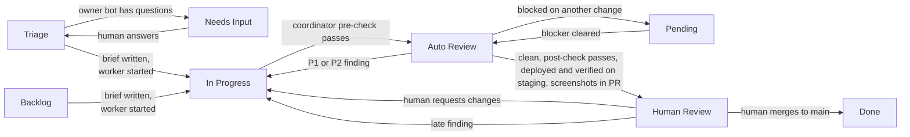

# Workflow

## Artifacts

- **Issue.** States one goal, the approach, and acceptance criteria. Work starts as an issue in Triage. The human decides what to build in a comment on that issue.
- **Brief.** The owner bot's instructions to one worker for one issue. See [briefs.md](briefs.md).
- **Pull request.** Branched from main and targeting main. It starts as a draft. One issue can produce several pull requests; each links the issue.
- **Board.** One card per issue or pull request. The column says what happens next.
- **Staging branch.** An integration branch that collects changes for testing on the staging environment. It is never merged into main.

## Board columns

| Column | Meaning | Who moves the card in | Holds |
|---|---|---|---|
| Triage | New work waiting for the owner bot to propose options and the human to decide | Human, coordinator, or tracker | Issues only |
| Backlog | Agreed scope, not started, and no worker is launched yet | Owner bot, coordinator, or human | Issues only |
| Needs Input | The owner bot has questions for the human on the issue | Owner bot | Issues only |
| In Progress | A worker is writing or fixing code. The pull request is a draft | Owner bot (on launch) or coordinator | Issues (until a PR links them) or pull requests |
| Auto Review | Ready for review. The pull request is marked ready and the automated reviewer is running | Coordinator | Pull requests only |
| Pending | Otherwise ready, but blocked on another change or an outside decision | Coordinator | Pull requests only |
| Human Review | Passed the gate. Waiting on the human | Coordinator, through the gate | Pull requests only |
| Done | Merged to main | Human, or the board on merge | Pull requests |

Moving a card to Auto Review also means marking the pull request ready. Moving it back to In Progress means converting it to a draft.

### Issues and pull requests on the board

Every pull request card must have a Status. Set a new card to In Progress if the pull request is a draft or is still being pushed. Otherwise, set it to Auto Review and request a review. Never leave its Status blank.

An issue with no pull request lives only in Triage, Backlog, Needs Input, or In Progress (while a worker is launched). Issues never sit in Auto Review, Pending, or Human Review.

Once a pull request links the issue on the host (`Fixes #N`, or `Part of #N` when one issue spans several pull requests), remove the issue card. The pull request card carries the work from then on. The link must actually appear on the host, not only in free text. Many open issues with no pull request is a failure: an agreed issue should promptly get a pull request.

## Triage

New issues and gripes enter Triage. Each issue must include code context for the relevant component, explain why the problem happens, and give two to four numbered fix options with a recommendation. A symptom and expected behavior alone are not enough. The maintainer should be able to choose with one comment.

Work starts as an issue in Triage. The owner bot comments on the issue with options. The human decides in a comment; that comment is the instruction for what to build, and edits to it count too. The coordinator forwards the human's comment to the owner bot.

The owner bot then either:

1. Moves the card to Needs Input and posts its questions on the issue, or
2. Writes a brief and moves the card to In Progress. The coordinator launches a coding worker from that brief. The worker branches from main with the pull request base set to main.

Parked items stay parked until the human says otherwise. Product choices belong to the owner bot; the coordinator does not invent them.

## The loop

1. An issue lands in Triage. The owner bot proposes options. The human decides in a comment.
2. The owner bot writes a brief (or asks for clarification in Needs Input first). The coordinator starts a worker. The card moves to In Progress.
3. The worker cuts a branch from main, opens a draft pull request early that links the issue, and pushes code with tests. The issue card leaves the board once the link is on the host.
4. The coordinator runs its pre-review check (see [review.md](review.md)).
5. The coordinator marks the pull request ready, moves the card to Auto Review, and requests an automated review.
6. For each P1 or P2 finding, the coordinator converts the pull request to a draft, moves the card to In Progress, and relays the finding to the worker with the root-cause rule. The worker fixes and pushes. The coordinator verifies the fix, resolves the thread, and returns to step 5.
7. After the round cap, the worker still fixes findings, but the coordinator verifies them itself and requests no more automated reviews.
8. When no P1 or P2 findings remain, the coordinator runs its post-review check.
9. The coordinator merges the change into the staging branch, redeploys staging, and checks that the commit staging serves contains the current head and that staging can run the change.
10. For any change a person can see, current screenshots or frames from staging go into the pull request description. The description also says where and how to see the change.
11. The coordinator checks the full gate in [review.md](review.md). Only if it passes does the card move to Human Review.
12. The human reviews. He merges to main, or sends the change back with comments, which returns it to step 6.

## Definition of ready

An issue is ready for a worker when:

- The human has decided what to build in a Triage comment (or otherwise approved the issue).
- It states the goal, the approach, and what is out of scope.
- It has acceptance criteria someone can check.
- The human's stated choices are written into it.
- It does not depend on unmerged work. If it does, keep it in Backlog until the dependency merges; do not put an issue in Pending.

## Definition of done

A change is done when:

- The human has merged it to main.
- Its tests ran green on the final head, with pass counts reported.
- Every review finding is fixed at its root cause, with neighboring cases tested.
- It ran on a staging deploy that contained its final head, with screenshots or frames in the pull request if it changed anything a person can see.
- No review threads are open.

## Blocked work

A pull request that is otherwise ready but waits on another change goes to Pending, not Auto Review or Human Review. Its body names the blocker. When the blocker merges, the coordinator rebases or merges main into the branch and resumes the loop. Issues waiting on blockers stay in Backlog, not Pending.
