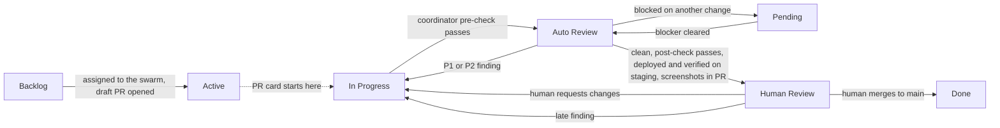

# Workflow

## Artifacts

- **Issue.** States one goal, the approach, and acceptance criteria. The human approves it before work starts.
- **Brief.** The coordinator's instructions to one worker for one issue. See [briefs.md](briefs.md).
- **Pull request.** One per issue, branched from main and targeting main. It starts as a draft.
- **Board.** One card per issue or pull request. The column says what happens next.
- **Staging branch.** An integration branch that collects changes for testing on the staging environment. It is never merged into main.

## Board columns

| Column | Meaning | Who moves the card in |
|---|---|---|
| Backlog | Approved or proposed, not started | Coordinator or human |
| Active | An open issue that is assigned to the swarm and has open sub-issues or a linked open pull request | Coordinator |
| In Progress | A worker is writing or fixing code. The pull request is a draft | Coordinator |
| Auto Review | Ready for review. The pull request is marked ready and the automated reviewer is running | Coordinator |
| Pending | Otherwise ready, but blocked on another change or an outside decision | Coordinator |
| Human Review | Passed the gate. Waiting on the human. Pull requests only | Coordinator |
| Done | Merged to main | Human, or the board on merge |

Moving a card to Auto Review also means marking the pull request ready. Moving it back to In Progress means converting it to a draft.

When the human approves an issue, the coordinator assigns it to the swarm and opens a draft pull request at once, with a closing link such as Fixes. Only then does the issue card move to Active. The issue never sits in Active without that link. A "Part of" mention is not a link.

Active holds only open issues that are assigned to the swarm and have open sub-issues or a linked open pull request. The pull request card keeps moving through In Progress, Auto Review, Pending, and Human Review. Do not move the issue card through those columns, and do not remove it from the board while a linked pull request is open, or while it still has open sub-issues.

When every open pull request that links the issue has merged or closed, and it has no open sub-issues, the issue leaves Active. If a pull request used Fixes (or an equivalent closing phrase) and GitHub closed the issue, the issue card goes to Done. If the issue is still open, it returns to Triage or Needs Input, as fits.

An issue with no pull request and no open sub-issues never goes in Human Review, Pending, or Active. If it is waiting on the human, put a question on it and leave it where it is.

The issue card stays in Active while its pull request is open. The pull request card moves through In Progress, Auto Review, Pending, and Human Review.

## The loop

1. The human approves an issue.
2. The coordinator writes a brief and starts a worker. The coordinator opens a draft pull request against main at once, with a closing link, assigns the issue to the swarm, and moves the issue card to Active. The pull request card moves to In Progress.
3. The worker cuts the branch from main if it is not already cut, and pushes code with tests to the pull request. The issue never sits in Active without a link.
4. The coordinator runs its pre-review check (see [review.md](review.md)).
5. The coordinator marks the pull request ready, moves the card to Auto Review, and requests an automated review.
6. For each P1 or P2 finding, the coordinator converts the pull request to a draft, moves the card to In Progress, and relays the finding to the worker with the root-cause rule. The worker fixes and pushes. The coordinator verifies the fix, resolves the thread, and returns to step 5.
7. After the round cap, the worker still fixes findings, but the coordinator verifies them itself and requests no more automated reviews.
8. When no P1 or P2 findings remain, the coordinator runs its post-review check.
9. The coordinator merges the change into the staging branch, redeploys staging, and checks that the commit staging serves contains the current head and that staging can run the change.
10. For any change a person can see, current screenshots or frames from staging go into the pull request description. The description also says where and how to see the change.
11. The coordinator checks the full gate in [review.md](review.md). Only if it passes does the card move to Human Review.
12. The human reviews. He merges to main, or sends the change back with comments, which returns it to step 6.

## Definition of ready

An issue is ready for a worker when:

- The human has approved it.
- It states the goal, the approach, and what is out of scope.
- It has acceptance criteria someone can check.
- The human's stated choices are written into it.
- It does not depend on unmerged work, or the dependency is named and the card can sit in Pending.

## Definition of done

A change is done when:

- The human has merged it to main.
- Its tests ran green on the final head, with pass counts reported.
- Every review finding is fixed at its root cause, with neighboring cases tested.
- It ran on a staging deploy that contained its final head, with screenshots or frames in the pull request if it changed anything a person can see.
- No review threads are open.

## Blocked work

A change that is otherwise ready but waits on another change goes to Pending, not Auto Review or Human Review. Its pull request body names the blocker. When the blocker merges, the coordinator rebases or merges main into the branch and resumes the loop.
