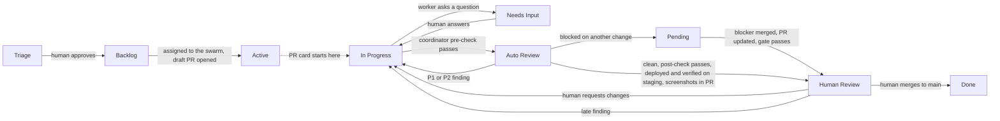

# Workflow

## Artifacts

- **Issue.** States one goal, the approach, and acceptance criteria. The human approves it before work starts.
- **Brief.** The coordinator's instructions to one worker for one issue. See [briefs.md](briefs.md).
- **Pull request.** One per issue, branched from main and targeting main. It starts as a draft.
- **Board.** One card per issue or pull request. The column says what happens next.
- **Staging branch.** An integration branch that collects changes for testing on the staging environment. It is never merged into main.

## Board columns

| Column | Holds | Who moves the card in |
|---|---|---|
| Inbox | Anything kept out of the flow for now. After launch, new tickets from customers. A sandboxed agent reviews each ticket, reproduces the problem if there is one, and suggests what to do | Anyone |
| Triage | Open issues only. Each has clear suggested plans from an agent. They wait on the human to decide whether or when to do the work, to choose a plan, or to send the issue back for more planning | Coordinator |
| Backlog | Open issues only. Each has an approved plan but is not in the current sprint. Workers can take these lower-priority issues when capacity is available | Human or coordinator |
| Active | Open issues only. Each is assigned to the swarm and has sub-issues or a linked open pull request | Coordinator |
| In Progress | Draft pull requests for active issues. A worker is working on each one now | Coordinator |
| Auto Review | Pull requests marked ready. The worker signed off and the automated, adversarial reviewer is running | Coordinator |
| Needs Input | Draft pull requests where the worker needs more information. The latest comment is a question from the worker or the coordinator that a human must answer, for example a missing decision, configuration, credential, or service | Coordinator |
| Human Review | Finished pull requests that are merged into the staging branch and deployed to staging. If possible, each has at least one screenshot and a short before-and-after summary in user terms. They wait on the human to test and merge to main | Gate only |
| Pending | Finished pull requests that would be in Human Review, but that cannot merge to main yet because they depend on another pull request. The pull request body names the blocker | Coordinator |
| Done | Pull requests merged to main | Human, or the board on merge |
| Canceled | Closed pull requests that will not be merged. This is an error state: work started that should not have started | Human or coordinator |
| Parked | Draft pull requests with real work that we decided not to merge into main or staging yet. Ideally this column is empty | Human or coordinator |

Moving a card to Auto Review also means marking the pull request ready. Moving it back to In Progress or Needs Input means converting it to a draft.

Issues and pull requests use different columns. Issues go in Inbox, Triage, Backlog and Active. Pull requests go in every column from In Progress to Parked. Do not remove an issue card when a pull request links it: the issue moves to Active and stays there while the pull request is open. When the human merges the pull request, close the issue, take it out of Active, and delete the branch. When the blocker of a Pending pull request merges, the coordinator updates the pull request and moves it on to Human Review through the gate.

## The loop

1. The human approves an issue.
2. The coordinator writes a brief and starts a worker. The issue card stays in Backlog.
3. The worker cuts a branch from main, opens a draft pull request early that links the issue, and pushes code with tests. As soon as the pull request exists, the coordinator moves the issue card to Active and the pull request card to In Progress. From then on only the pull request card moves through the pull request columns.
4. The coordinator runs its pre-review check (see [review.md](review.md)).
5. The coordinator marks the pull request ready, moves the card to Auto Review, and requests an automated review.
6. For each P1 or P2 finding, the coordinator converts the pull request to a draft, moves the card to In Progress, and relays the finding to the worker with the root-cause rule. The worker fixes and pushes. The coordinator verifies the fix, resolves the thread, and returns to step 5.
7. After the round cap, the worker still fixes findings, but the coordinator verifies them itself and requests no more automated reviews.
8. When no P1 or P2 findings remain, the coordinator runs its post-review check.
9. The coordinator merges the change into the staging branch, redeploys staging, and checks that the commit staging serves contains the current head and that staging can run the change.
10. For any change a person can see, current screenshots or frames from staging go into the pull request description. The description also says where and how to see the change.
11. The coordinator checks the full gate in [review.md](review.md). Only if it passes does the card move to Human Review.
12. The human reviews. He merges to main, or sends the change back with comments, which returns it to step 6.

## Definition of ready

An issue is ready for a worker when:

- The human has approved it.
- It states the goal, the approach, and what is out of scope.
- It has acceptance criteria someone can check.
- The human's stated choices are written into it.
- It does not depend on unmerged work, or the dependency is named in the issue. If its finished pull request still waits on that work, the pull request card waits in Pending.

## Definition of done

A change is done when:

- The human has merged it to main.
- Its tests ran green on the final head, with pass counts reported.
- Every review finding is fixed at its root cause, with neighboring cases tested.
- It ran on a staging deploy that contained its final head, with screenshots or frames in the pull request if it changed anything a person can see.
- No review threads are open.

## Blocked work

A change that is otherwise ready but waits on another change goes to Pending, not Auto Review or Human Review. Its pull request body names the blocker. When the blocker merges, the coordinator rebases or merges main into the branch and resumes the loop.

A change that waits on a person or on the environment, such as a decision, missing configuration, credentials, or a service that staging lacks, does not go to Pending. Convert the pull request to a draft, move the card to Needs Input, and post a comment that names what is missing and who must provide it. When the answer or the missing item arrives, the loop resumes as described in the gate in [review.md](review.md).
