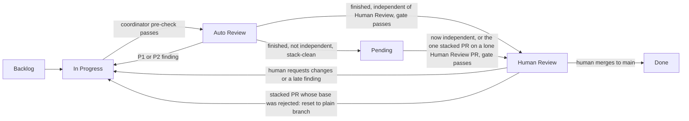

# Workflow

## Artifacts

- **Issue.** States one goal, the approach, and acceptance criteria. The human approves it before work starts.
- **Brief.** The coordinator's instructions to one worker for one issue. See [briefs.md](briefs.md).
- **Pull request.** One per issue, branched from main and targeting main. It starts as a draft.
- **Board.** One card per issue or pull request. The column says what happens next.
- **Staging branch.** An integration branch that collects changes for testing on the staging environment. It is never merged into main.

## Board columns

| Column | Meaning | Who moves the card in |
|---|---|---|
| Backlog | Approved or proposed, not started | Coordinator or human |
| In Progress | A worker is writing or fixing code. The pull request is a draft | Coordinator |
| Auto Review | Ready for review. The pull request is marked ready and the automated reviewer is running | Coordinator |
| Pending | A short, ordered buffer of finished pull requests (target: three) that are not independent of Human Review. Each one already merges cleanly onto main, onto every Human Review pull request, and onto every Pending pull request ahead of it. The pull request body names that stack. If the plain branch conflicts with the stack, a worker creates a <branch>-vN rebase (v0 is the original branch) and the card stays in In Progress until that branch is pushed and stack-clean. The coordinator starts new work only to refill this buffer | Coordinator or gate |
| Human Review | Finished pull requests that passed the gate, are on staging, and wait on the human to test and merge to main. Any number of independent pull requests, plus at most one stacked pull request when only its base is there. See [Just-in-time review](#just-in-time-review) | Gate only |
| Done | Merged to main | Human, or the board on merge |

Moving a card to Auto Review also means marking the pull request ready. Moving it back to In Progress means converting it to a draft.

An issue card stays on the board only until a pull request links it. Once a pull request links the issue, remove the issue card. The pull request card carries the work from then on, so each change shows up once and Human Review lists only pull requests. An issue with no pull request never goes in Human Review or Pending. If it's waiting on the human, put a question on it and leave it where it is.



## The loop

1. The human approves an issue.
2. The coordinator writes a brief and starts a worker. The card moves to In Progress.
3. The worker cuts a branch from main, opens a draft pull request early, and pushes code with tests.
4. The coordinator runs its pre-review check (see [review.md](review.md)).
5. The coordinator marks the pull request ready, moves the card to Auto Review, and requests an automated review.
6. For each P1 or P2 finding, the coordinator converts the pull request to a draft, moves the card to In Progress, and relays the finding to the worker with the root-cause rule. The worker fixes and pushes. The coordinator verifies the fix, resolves the thread, and returns to step 5.
7. After the round cap, the worker still fixes findings, but the coordinator verifies them itself and requests no more automated reviews.
8. When no P1 or P2 findings remain, the coordinator runs its post-review check.
9. The coordinator merges the change into the staging branch, redeploys staging, and checks that the commit staging serves contains the current head and that staging can run the change.
10. For any change a person can see, current screenshots or frames from staging go into the pull request description. The description also says where and how to see the change.
11. The coordinator checks the full gate in [review.md](review.md). A finished pull request that is independent of every Human Review pull request goes to Human Review. Human Review has no size limit for independent pull requests. A finished pull request that is not independent goes to Pending if it is clean on the current stack. When Human Review holds only one pull request and the next finished work depends on it, one stacked pull request can enter (see [Stacked pull requests](#stacked-pull-requests)). If a pull request enters with a vN tip as its head, the coordinator first installs the tip and reruns the checks and staging verification on it. A vN tip built on a pull request that was sent back is never installed.
12. The human reviews. If he merges to main, the card goes to Done, and the coordinator promotes every Pending pull request that is now independent. If he sends the change back, the card returns to step 6. Before anything else, the coordinator resets a stacked pull request built on it (see [Stacked pull requests](#stacked-pull-requests)). Then it promotes every Pending pull request that is now independent and re-checks the rest of the buffer against the new stack. Start new In Progress work only to refill Pending up to the target.

## Definition of ready

An issue is ready for a worker when:

- The human has approved it.
- It states the goal, the approach, and what is out of scope.
- It has acceptance criteria someone can check.
- The human's stated choices are written into it.
- It is not started just to sit behind other work. New In Progress work starts only to refill the Pending buffer.

## Definition of done

A change is done when:

- The human has merged it to main.
- Its tests ran green on the final head, with pass counts reported.
- Every review finding is fixed at its root cause, with neighboring cases tested.
- It ran on a staging deploy that contained its final head, with screenshots or frames in the pull request if it changed anything a person can see.
- No review threads are open.

## Just-in-time review

Human Review is a buffer for the human's attention. Keep at least two pull requests there when finished work allows it.

Human Review holds any number of independent pull requests. A pull request is independent when it merges cleanly onto main, it contains no unmerged commits of another Human Review pull request, and it merges cleanly together with each Human Review pull request. The human can merge or reject each independent pull request without an effect on the others.

Pending is a small buffer of finished pull requests that are not independent of Human Review. Each Pending pull request must merge cleanly onto main, onto every Human Review pull request, and onto every Pending pull request ahead of it, in queue order. The pull request body names that stack. When a Pending pull request becomes independent, for example because the pull request it conflicted with merged, it goes to Human Review.

If a finished pull request's plain branch conflicts with the stack, a worker rebases the work onto the stack as <branch>-vN (the next free number; v0 is the unadorned original). The worker pushes that branch only and leaves the original branch and the pull request head untouched. The card stays in In Progress until the vN branch is pushed and is stack-clean, and then it may enter Pending.

Before a pull request enters Human Review with a vN tip as its head, the coordinator installs the tip: it moves the pull request branch to the commit that the worker pushed and tested. This is not new code, so the coordinator or its gate tooling can do it, but only before the card enters Human Review. Never move the branch of a card that is in Human Review. Then the coordinator reruns the tests, the post-check, and the staging merge, redeploy and verification on the new head. Only then does it try to promote the pull request through the gate. Never run the gate on the old head and update the head after, because the old head may conflict with main and a new head voids the checks and staging evidence. A pull request is rejected when the human sends it back or closes it unmerged. Every vN tip built on a rejected pull request is invalid, in Pending and in Human Review, and is never installed, even if the tip later looks independent because the rejected pull request left Human Review. The worker builds a new vN tip without the rejected work. If a pull request was rejected, the coordinator re-checks every remaining Pending pull request against the new stack and requests a new vN branch only when the plain branch no longer applies cleanly. A Pending pull request whose plain branch is still clean keeps that branch.

The target size of the Pending buffer is three. The In Progress column should stay small (at most three). Start new work only to refill Pending. The buffer runs empty only when there is no remaining work.

### Stacked pull requests

Use a stacked pull request only when Human Review holds exactly one pull request (A) and the next finished pull request (B) depends on A or conflicts with it. Then B can enter Human Review as a stacked pull request, so that the human has two items to review. Rules:

- Human Review holds at most one stacked pull request. A is not itself stacked.
- The rule "A is the only pull request in Human Review" applies when B enters. After B is in Human Review, B stays eligible while A is in Human Review, even when independent pull requests enter next to them.
- B's head is its vN tip, built on A. It contains A's commits and merges cleanly onto main plus A. Before the coordinator installs the tip, it saves B's plain tip as <branch>-v0, so that the plain content stays available.
- B's pull request body starts with this banner, before any other text. Replace A with the number of the base pull request:

  ```
  # STACKED ON #A: MERGE #A INTO MAIN FIRST

  > **This pull request contains the changes of #A.** Merge it only after #A is merged into main.
  > If #A is rejected, do not merge this pull request. The coordinator resets it to its plain branch,
  > without the changes of #A, before it can be merged.
  ```

- Independent pull requests can still enter Human Review next to A and B. Each one must merge cleanly together with A and with B.
- The gate fails a stacked pull request when the banner is missing or is not at the top, when its head contains a Human Review pull request's commits but has no banner, or when its base was closed unmerged or has left Human Review.

If the human merges A, the coordinator checks that B still merges cleanly onto main. If it does, the coordinator removes the banner. No other change is needed. If it does not, for example because A was squash-merged and B still carries A's original commits, the coordinator moves B out of Human Review to In Progress, and asks the worker to rebuild B on the current main without replaying A. Then B goes through the normal loop again.

If the human rejects A (closes it unmerged, or sends it back so that it leaves Human Review), B must never be merged with A's changes. The coordinator acts at once, before the human can merge B:

1. It moves B's card out of Human Review to In Progress. This comes first, so that the branch of a card in Human Review is never moved.
2. It resets B's branch to the saved plain tip (<branch>-v0) and removes the banner. If no plain tip was saved, it asks the worker to rebuild B on main without A's commits.
3. It runs the normal loop again on the new head: tests, review, post-check, staging, screenshots, and the gate. B can then enter Human Review again as an independent pull request.
